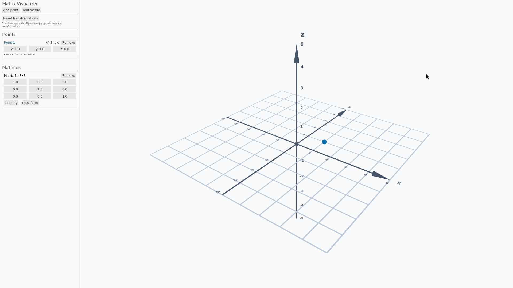

# matrix-visualizer

For visualizing matrices and transformations in both 2D and 3D.

As of 20/10/2026, looks like this: 

Checklist

- [x] Implement the grid
  - [x] Decide on what type of camera to use
  - [x] Draw 2D/3D grid lines
  - [x] Add labels (x, y, z), numbers and arrowheads
  - [x] Make the spacing between grid lines based on magnification
  - [ ] Allow for a “2D mode” that locks the camera to the x-y plane

- [x] Make input boxes
  - [x] How should matrices be entered?
  - [x] A “transform” button for matrices (that affects the grid)
  - [ ] Different types of boxes (matrix, point, vector, polygon)
  - [ ] Consider accessibility?

- [x] Draw points/vectors that the user enters
  - [x] User should be able to hide them
  - [x] Each drawn point/vector color-coded to its respective input box
  - [ ] Enclosed area by a polygon should be shaded

- [x] Transforming
  - [ ] Toggle for whether the grid itself is affected by transformations
  - [ ] Should the camera “follow” the transformation?
  - [ ] Animated with some easing function

